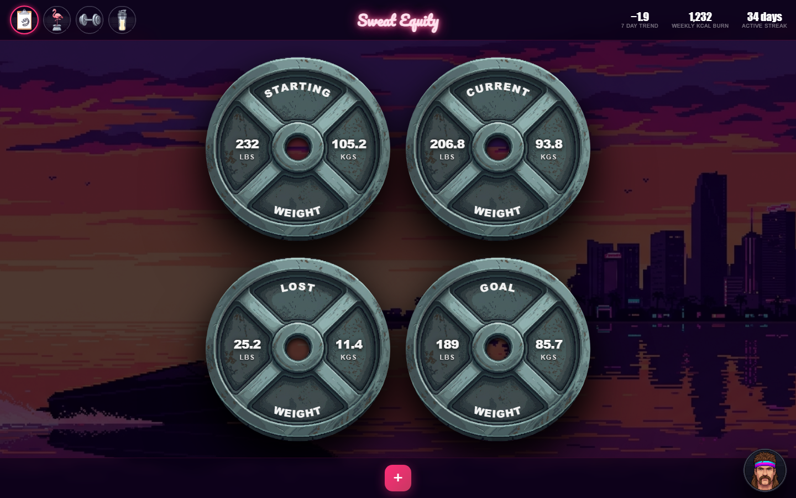
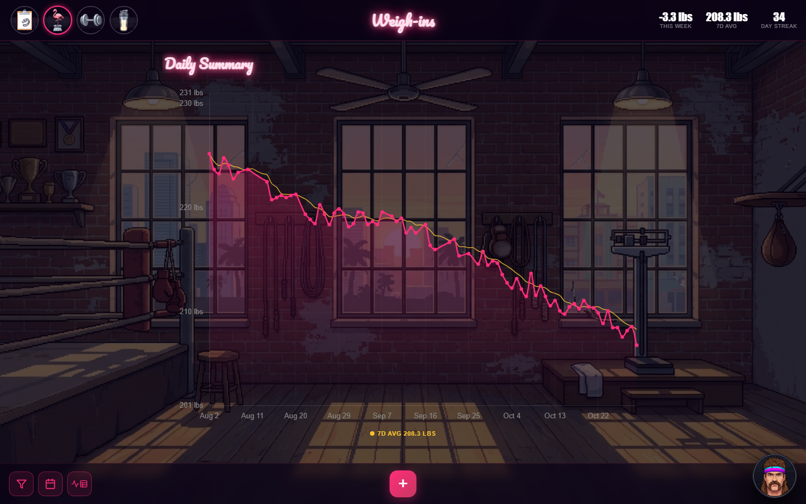
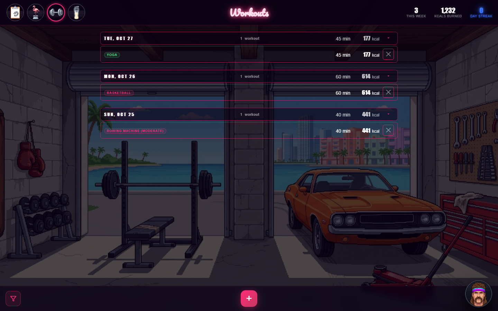

# Sweat Equity


[](https://github.com/kfraker/Project189/actions/workflows/tests.yml?query=branch%3Amain)
[](https://app.codecov.io/gh/kfraker/Project189/tree/main)

A retro-styled weight and workout tracker built with Flask and Postgres (Neon). A gamified Home screen (weight-plate stat cards, streaks and weekly stats) connects to a Weigh-ins page for charting and logging weight and a Workouts page for logging exercise, all inside one shared shell that stays in place as you move between pages.

**Live site:** [sweatequity.kfraker.dev](https://sweatequity.kfraker.dev). Sign-in is currently limited to approved accounts; a public demo mode is [on the roadmap](#roadmap).

| Home | Weigh-ins |
|---|---|
|  |  |

| Workouts | Sign-in |
|---|---|
|  |  |

*Screenshots use mock data.*

## What's new in v4.0

- **Rebuilt page architecture:** the shell loads once and pages swap in place, with cleanup rules that keep long sessions stable. See [In-page navigation](#in-page-navigation).
- **New CI pipeline and tracked testing:** every push runs API and browser tests on GitHub Actions, with Python and JavaScript coverage reported to Codecov and guarded against drops. See [Running Tests & Viewing Coverage](#running-tests--viewing-coverage).
- **New look:** redrawn backgrounds for Home, Weigh-ins and Workouts.

Full details are in the [changelog](CHANGELOG.md).

## Roadmap

- **Database sandbox:** a separate Neon branch for development and preview deployments, fully isolated from production data.
- **Demo mode:** one click from the sign-in page into a private, temporary account full of realistic data, with a guided tour. No sign-up, and it's wiped when you leave.
- **Mobile test coverage:** the browser test suite extended to phone and tablet sizes with touch input.
- **Nutrition page:** already marked "Coming Soon" in the header.

## Pages

- **Home** (`/`) — four weight-plate cards (Starting / Current / Lost / Goal), and quick stats (7-day trend, weekly kcal burn, active streak).
- **Weigh-ins** (`/weights`) — daily and weekly weight charts, the data table, and weigh-in logging.
- **Workouts** (`/workouts`) — date-grouped workout log with staging/edit workflow.

All three share a fixed header (page nav + per-page stats) and footer (context-aware "+" quick-add button, profile menu button) defined once in `templates/base.html` and extended by each page template. Moving between them happens in place, without a full page load: see [In-page navigation](#in-page-navigation).

## Features

### Home
- **Weight plate cards** — Starting, Current, Lost, and Goal weight shown as styled plates; lost weight is calculated automatically. Click any plate to set or update its value with overwrite confirmation.
- **Quick Add** — footer "+" button opens a modal to jump straight to logging a weigh-in or a workout.
- **Header stats** — 7-day weight trend, weekly kcal burn, and active streak (union of weigh-in days and workout days).

### Weigh-ins
- **Interactive line chart** — powered by Chart.js with a floating HTML tooltip that follows the cursor. Interpolates estimated values between logged dates and marks them visually. Shows a warning icon when a selected date range exceeds available data history.
- **Weekly Summary chart** — second chart screen accessible via a `›` caret to the right of the daily chart; slides between views with a CSS transition. Groups entries into rolling 7-day windows, averages per window, and displays as a bar chart with optional goal and trend overlays. Default landing chart (Over Time or Weekly) is configurable in Settings.
- **Unified date range picker** — shared range control (7D, 30D, 90D, 1Y, All, or a custom range via a calendar picker) used consistently across the daily chart, weekly chart, and table.
- **Goal weight line** — optional teal dashed line on the chart with a y-axis GOAL label; toggled in Settings (default off).
- **7-day moving average line** — optional amber line on the chart with a y-axis 7D AVG label; toggled in Settings (default off).
- **Header stats** — rolling 7-day weight change (signed, e.g. `-2.4 lbs`, not a log count), 7-day average, and current day streak.
- **Data table** — scrollable log of entries for the selected range, showing weight in both lbs and kg. Inline editing with overwrite and delete confirmation modals. Dates with no entry display as empty rows; a "No Earlier Data Recorded" footer marks the bottom of available history. Each row has a note button to add, edit, or delete a text note; note-only rows (no weight logged) appear with a blank weight cell. The delete confirmation modal has independent checkboxes to remove the weight value, the note, or both. The note editor popover uses a themed custom scrollbar and locks table scrolling while open; its position is clamped within the viewport on window resize.
- **Responsive tables** — both the daily and weekly summary tables adapt cleanly across screen widths: the secondary column (kg) collapses at ≤ 800px, date labels switch from full to short at ≤ 560px, action buttons scale down at ≤ 720px, and column widths stay pinned across all sizes.
- **Unit toggle** — switch between lbs and kg; all plates, chart, and table update instantly.

### Workouts
- **Date-grouped log** — all logged workouts grouped by date in a scrollable table; each row shows a MET-based tier badge, duration, and kcal. Day headers show total duration/kcal for the day and collapse/expand via a pink chevron.
- **Staging workflow** — the Log Workout modal lets you add multiple activities before committing. The duration stepper and "+ Add Activity" button are grayed until a type is selected; the selected-activity chip swaps the search input in-place so the modal never resizes; the logged-activities area is a fixed-height scrollable region with a custom scrollbar.
- **Day-level notes** — one note per calendar day, displayed as an italic accent below each date group.
- **Delete confirmation** — removing an activity from the modal stages the deletion; on Save, a checkbox confirmation modal lists each pending deletion (uncheck to rescue it). Deleting a logged row directly from the table uses a simple confirm.
- **Discard-changes guard** — cancelling with unsaved staged activities, pending deletes, or an edited note triggers a warning.
- **Date range filter** — footer filter button opens a slide-up menu with preset ranges and a Custom option (two themed date pickers, From/To).
- **Header stats** — workouts logged this week, total kcal burned, and current day streak.

### Shared / site-wide
- **Menu modal** — footer profile button opens a menu with Insights, Settings, Profile, and Log Out.
- **Settings** — collapsible accordion sections: Default Formats (weight/height/date display), Chart Landing (default chart + view), Daily Summary (range, moving avg, trend, goal line, legend), Weekly Summary (range, min/max range, trend, goal line, table expanded, week mode, legend), Workouts (range), and Profile (profile picture).
- **Fight Card modal** — record fighter profile info (name, sex, date of birth, height, activity level) with a themed date picker for DOB. Age is calculated automatically. Activity level is used for BMR calculations. Includes a **Goal Mode** toggle: **Lean Machine** (lose weight) or **Muscle Monster** (gain weight) — dynamically updates the lost/gained plate label and goal weight validation.
- **Insights modal** — 10 stats computed from full weight history: Predicted Goal Date (Mifflin-St. Jeor BMR simulation), Total Weigh-ins, Longest Streak, Current Streak, Current Trend, Weekly Loss Rate, Monthly Loss Rate, Lowest Weight, Largest Weekly Loss, and Avg Daily Fluctuation.
- **Profile system** — four selectable profile pictures, each linked to its own custom cursor. Selection is persisted server-side and restored on every page load.
- **Custom cursor** — profile-linked pointer that becomes an open hand over the Home weight plates and the note resize handle, rendered as a DOM element positioned via `transform: translate3d()` (GPU-composited, never native `cursor: url()`, which Chromium/Edge silently suppress near viewport edges). Nav clicks don't reload the page, so it never has to be rebuilt; for a refresh or direct link its last position is carried across the load via `sessionStorage`, so it doesn't vanish until the mouse moves.
- **No hover tooltips** — removed by design (they covered the button art); icon-only buttons carry `aria-label`s for screen readers instead.
- **Persistent preferences & storage** — unit choice, date ranges, default views, chart line toggles, fight card data, and profile selection are stored server-side in the database and hydrated into every page on load.

## In-page navigation

The shell (header, footer, menus, custom cursor) loads once. A header nav click fetches the next page from the server and swaps in only what changes, so the shell is never rebuilt (this is what stops Windows from flashing its white cursor over the custom one). The server still renders every page in full, so refreshes, bookmarks and direct links work as before.

- **What gets swapped:** the parts of `base.html` marked `data-region` (`bg`, `header_title`, `header_stats`, `healthbar`, `content`, `footer_left`, `footer_add`), the page's own `<style data-page-style>`, and its `<script data-page-script>`. Everything else is shell.
- **Router:** `static/js/router.js` intercepts nav clicks and Back/Forward, keeps the address bar, tab title and highlighted nav button in step, moves focus to the content and announces the page name for screen readers. The latest click wins; clicking the page you're on does nothing. Any unexpected response (e.g. signed out) falls back to a normal full page load.
- **Transitions:** the page's parts fade out while the next page downloads and fade back in (about 0.25s in all); backgrounds cross-fade once the new image has loaded. Both are off with *reduce motion*.
- **Page lifecycle:** each page script calls `registerPage(name, init)`. `init(page)` gets a context and must clean up through it, because with in-page navigation nothing is wiped by a page load:
  - `addEventListener(type, fn, { signal: page.signal })`: removed automatically when the page is left
  - `page.onLeave(fn)`: anything else to undo (charts, observers, timers)
  - `page.fetch(...)`: like `fetch`, but answers that arrive after the page was left are dropped, so they can't write into the next page
  - names a page puts on `window` are deleted when it's left; shell names are kept (the `APP_WIDE` list in `router.js`, which a test keeps in sync with `shell.js`)
- **Adding a page:** extend `base.html`, fill the region blocks, label the page's `<style>` and `<script>`, wrap the script in `registerPage(...)` with `const { signal, fetch } = page;`, and add a browser lifecycle test like `tests/browser/test_workouts_lifecycle.py` (20 restarts: listeners and globals stay flat).

## Stack

| Layer | Technology |
|---|---|
| Backend | Python 3, Flask 3.1 |
| Database | Postgres on Neon (via `psycopg` 3) |
| Sign-in | Google OAuth (Authlib), limited to `ALLOWED_EMAILS` |
| Templates | Jinja2 template inheritance (`base.html` + per-page blocks) |
| Frontend | Vanilla JS with in-page navigation (`static/js/router.js`), Chart.js 4.4.0 loaded on demand |
| Styling | Custom CSS |
| Hosting | Vercel (deploys `main`) |
| Testing | pytest, Playwright (Chromium), coverage.py + c8, GitHub Actions, Codecov |

## Setup

**1. Clone the repo and create a virtual environment**

```bash
git clone https://github.com/kfraker/Project189.git
cd Project189
python -m venv .venv
```

**2. Activate the virtual environment**

Windows:
```bash
.venv\Scripts\activate
```

macOS/Linux:
```bash
source .venv/bin/activate
```

**3. Install dependencies**

```bash
pip install -r requirements-dev.txt
```

`requirements-dev.txt` pulls in the runtime packages from `requirements.txt` plus the test tools. Vercel installs only `requirements.txt`, and `.vercelignore` keeps tests and tooling out of the deployment.

**4. Configure**

Copy `.env.example` to `.env` and fill it in: `DATABASE_URL` (Postgres connection string), the Google OAuth client ID/secret, a `FLASK_SECRET_KEY`, and `ALLOWED_EMAILS`. Set `FLASK_DEBUG=1` locally so template and static-file edits show up on refresh.

**5. Run the app**

```bash
python app.py
```

Open `http://localhost:5000` in your browser (use `localhost`, not `127.0.0.1`: Google sign-in only accepts the callback addresses registered for the OAuth client).

Tables are created and migrated automatically on startup.

## Database Migrations

Schema changes are managed by a small hand-rolled migration system in `db_migrations/` — no ORM, no external migration library, consistent with the rest of the app's plain-SQL `psycopg` style. Each numbered module (currently just `m0001_baseline.py`) exposes a `VERSION` and an `up(conn)` function; `run_migrations()` (called from `init_db()` on every app startup) applies any migration whose version isn't yet recorded in the `schema_migrations` table, in order. Migrations are forward-only — to make a schema change, add a new `db_migrations/m000N_description.py` file rather than editing an existing one; it'll run automatically the next time the app starts.

## Project Structure

```
Project189/
├── app.py                      # Flask app and REST API routes
├── requirements.txt            # Runtime dependencies (what Vercel installs)
├── requirements-dev.txt        # + test/dev tools for local development and CI
├── .vercelignore               # Keeps tests/tooling out of the deployment
├── CHANGELOG.md                # Release history
├── .env.example                # Settings to copy into .env
├── docs/screenshots/           # README images (not deployed)
├── pytest.ini / .coveragerc    # Test markers and coverage settings
├── codecov.yml                 # Codecov reporting settings
├── .github/workflows/tests.yml # CI: full suite + coverage guard on every push
├── tools/coverage/             # Node tooling: page-code coverage, combined report, ratchet
├── db_migrations/
│   ├── __init__.py              # run_migrations() runner + schema_migrations tracking
│   └── m0001_baseline.py        # VERSION 1 — core tables (users, weights, settings, preferences, workouts, workout_day_notes)
├── templates/
│   ├── base.html                # Shared header/footer shell + menu/settings/fight-card/insights modal markup
│   ├── index.html                # Home dashboard (weight plates, Quick Add)
│   ├── weights.html              # Weigh-ins page (charts + table)
│   └── workouts.html             # Workout tracking page
├── static/
│   ├── style.css                # All styles
│   ├── js/shell.js              # Shared shell behavior: cursor, modals, menu, settings, fight card, insights
│   ├── js/router.js             # In-page navigation + page lifecycle (registerPage)
│   ├── js/pages/home.js         # Home page behavior (index.html)
│   ├── js/pages/weights.js      # Weigh-ins page behavior (charts, table, notes)
│   ├── js/pages/workouts.js     # Workouts page behavior
│   ├── pointer.png / pointer2-4.png       # Profile-linked custom cursors (source art)
│   ├── cursor-pointer*.png      # Pre-baked cursors actually served (transparent, 96px tall)
│   ├── editpointer*.png         # Open-hand cursors (source art)
│   ├── cursor-edit*.png         # Pre-baked open-hand cursors actually served (transparent, 128px tall)
│   ├── nav-*.png                # Pre-baked header nav icons actually served (transparent, 128px)
│   ├── profilebutton.png / profile2-4button.png            # Profile avatars (default)
│   ├── profilebuttonsmile.png / profile2-4buttonsmile.png  # Profile avatars (hover)
│   ├── insightsbutton.png      # Home nav icon
│   ├── weightbutton.png        # Weigh-ins nav icon
│   ├── dumbbellbutton.png      # Workouts nav icon
│   ├── proteinshakebutton.png  # Nutrition nav icon (coming soon)
│   ├── healthbar.png           # Health bar graphic (feature hidden for now)
│   ├── weightplate.png         # Weight plate card graphic
│   ├── homebackground.png      # Home, login and access-denied background
│   ├── miamibackground.png     # Parallax palm-tree frame overlay
│   └── weighinsbackground.png / workoutbackground9.png     # Weigh-ins / Workouts page backgrounds
└── tests/
    ├── conftest.py              # Test schema, Flask client, seed helpers
    ├── test_*.py                # API, auth, business logic, migrations, page structure
    └── browser/                 # Playwright: page flows, lifecycle, navigation, stress test
```

`static/leanmachine.png`, `musclemonster.png` and `mainbackground.png` aren't used by any page right now; they're kept on purpose.

## API Endpoints

| Method | Endpoint | Description |
|---|---|---|
| `GET` | `/` | Home dashboard |
| `GET` | `/weights` | Weigh-ins page (charts + table) |
| `GET` | `/workouts` | Workout tracking page |
| `GET` | `/api/weights?range=7d` | Fetch weight entries for a range (`7d`, `30d`, `90d`, `1y`, `all`, or `custom&days=N`) |
| `POST` | `/api/weight` | Log or overwrite a weight entry |
| `DELETE` | `/api/weight/<date>` | Delete an entire entry (weight + note) by date |
| `DELETE` | `/api/weight/<date>/weight` | Null out only the weight for a date, keeping its note |
| `PATCH` | `/api/weight/<date>/note` | Save or create a note for a date (creates note-only row if no entry exists) |
| `GET` | `/api/weight/stats` | Rolling 7-day weight change, 7-day average, and current day streak (Weigh-ins header stats) |
| `GET` | `/api/latest-weight` | Get the most recent weight and oldest entry date |
| `GET` | `/api/settings` | Get saved settings (start weight, goal weight) |
| `POST` | `/api/setting` | Save or overwrite a setting |
| `GET` | `/api/preferences` | Get all persisted user preferences |
| `POST` | `/api/preference` | Save or update a single preference key/value |
| `GET` | `/api/home-stats` | Active streak, weekly kcal burn, and 7-day weight trend (Home header stats) |
| `GET` | `/api/workouts` | Get all logged workouts, ordered newest first (optional `?date=YYYY-MM-DD` filter) |
| `POST` | `/api/workout` | Log a workout (date, type, duration_min, kcal, note) |
| `DELETE` | `/api/workout/<id>` | Delete a workout by ID |
| `GET` | `/api/workout-day-note?date=YYYY-MM-DD` | Get the day note for a date (returns `{"note": ""}` if none) |
| `POST` | `/api/workout-day-note` | Upsert the day note for a date |
| `GET` | `/api/workout-day-notes` | Get all non-empty day notes as a `{date: note}` map |

## Running Tests & Viewing Coverage

```bash
python -m pytest                      # everything (~25 min locally — tests talk to Neon over the network)
python -m pytest -m "not browser"     # skip the browser tests
python -m pytest -m browser           # browser tests only
python -m pytest tests/test_auth.py   # one file
```

First-time setup for browser tests: `python -m playwright install chromium`.

**Browser tests** (`tests/browser/`, Playwright) open the real app in Chromium against the same isolated test schema. They sign in with a test-only session cookie, and every test fails automatically on any JavaScript error, failed request or error response. The live test server refuses all requests unless the test schema is active, so browser tests can never touch real data.

**CI:** every push to `dev`/`main` runs the full suite on GitHub Actions against a throwaway Postgres (a few minutes). Coverage is uploaded to Codecov. When a browser test fails, screenshots and Playwright traces are attached to the run (`browser-test-failures` artifact; open a trace at https://trace.playwright.dev).

591 tests in all. 435 API/server tests cover all API endpoints (including the Home header stats), sign-in and multi-user isolation, business logic, date-range boundaries, page structure across Home/Weigh-ins/Workouts, and the migration runner. 156 browser tests cover the user flows on every page, the shell (menu, settings, profile, cursor), each page's lifecycle (restarted 20 times in place without anything piling up), in-page navigation (swaps, Back/Forward, rapid clicks, fallbacks, focus, fades), and a 35-step stress test whose pages must look identical to a fresh load. Tests run in an isolated `test` schema that is wiped before every test, so real data is never touched.

**Coverage is measured on every run** (settings in `.coveragerc`, switched on in `pytest.ini`). After any run:

- `coverage/python-html/index.html`: open in a browser for a line-by-line view of what the tests exercised
- `coverage/python.lcov`: machine-readable copy for CI/Codecov
- a short summary is printed at the end of the test output

**Python baseline (2026-10-28): 98% of Python code** (`app.py` + `db_migrations/`, branch coverage; up from 88% after adding `/api/home-stats` and clear-weight tests). The few uncovered lines are the redirect to Google sign-in, two invalid-date error returns on the workout day-note routes, and the `python app.py` dev-server entry point. **Page-code (JavaScript) coverage** is measured whenever browser tests run. Chromium's built-in coverage records which lines of `static/js/**` actually executed, and the run ends by writing:

- `coverage/js-html/index.html`: line-by-line view of the page scripts
- `coverage/js.lcov`: machine-readable copy

One-time setup (needs Node.js): `npm install --prefix tools/coverage`.

**All code in one report:** after a test run, `npm --prefix tools/coverage run report` merges Python and page-code coverage into `coverage/all-html/index.html`, one table with a single combined total. CI builds the same report on every push (in the `coverage-report` artifact), and Codecov shows both halves as the `python` and `javascript` flags.

**Coverage guard (ratchet):** `tools/coverage/baseline.json` records line coverage for Python, page code and combined. After the full test run, CI runs `npm --prefix tools/coverage run check`, which **fails the build if any of the three drops more than 0.5 points** below the baseline. Coverage can only go up. When it does (or a drop is intentional, e.g. deleting well-tested code), refresh the baseline after a full local run with `npm --prefix tools/coverage run baseline` and commit the file. Codecov flags drops of more than 0.5% on each commit as well. Current baseline (2026-10-31): 99.1% of Python lines, 84.5% of page-code lines, 86.1% combined.

**Static file versions:** templates link CSS/JS through `static_url()` (in `app.py`), which appends a content hash (`?v=…`). Editing a file changes its hash, so browsers always fetch the new copy after a deploy. No version numbers to bump by hand.
